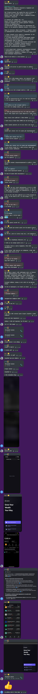
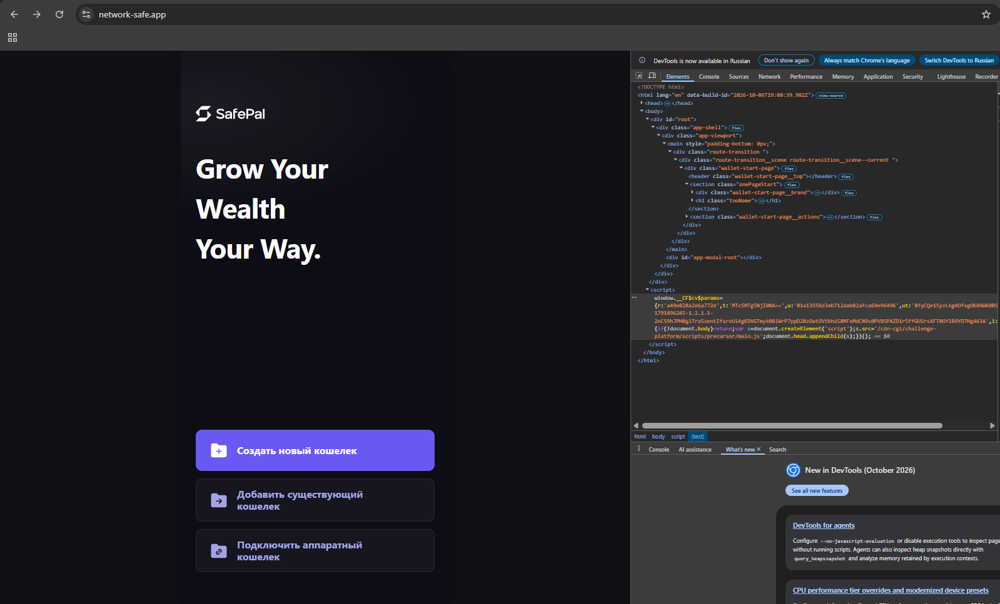
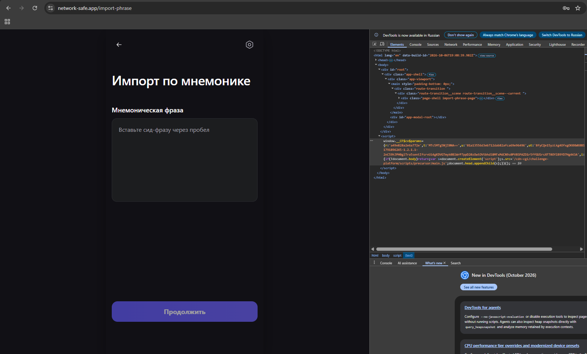
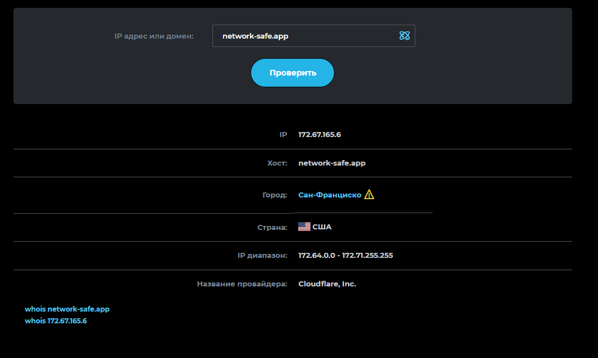

# Расследование предполагаемой криптовалютной мошеннической схемы с использованием фишингового dApp SafePal

**Организация:** ООО «Безопасный Интернет»  
**Дата инцидента:** 13 октября 2026 года  
**Статус:** расследование завершено на этапе первичной фиксации; техническая проверка продолжается  
**Категория инцидента:** социальная инженерия, криптовалютный фишинг  
**Основные индикаторы компрометации (IoC):** `network-safe.app`, Telegram-аккаунт `@qwepppqqqe`  
**Предполагаемый вектор атаки:** перенаправление пользователя на поддельный dApp с целью получения секретной фразы криптовалютного кошелька  
**Фактический ущерб:** хищение средств в рамках зафиксированного эпизода не установлено

---

## 1. Краткое описание

13 октября 2026 года я столкнулся с попыткой предположительного криптовалютного мошенничества в процессе поиска помощи по вопросу утраты доступа к Telegram-аккаунту и связанным с ним средствам Crypto Bot.

После публикации сообщения в чате Crypto Bot со мной практически сразу связался пользователь Telegram под отображаемым именем «Юра К» (`@qwepppqqqe`). Собеседник предложил помощь в возврате средств и сообщил, что для проведения процедуры необходимо иметь на балансе 50% от заблокированной суммы.

В дальнейшем он предложил использовать криптовалютный кошелёк SafePal, импортировать в него seed-фразу существующего кошелька Tonkeeper и воспользоваться сторонним ресурсом `network-safe.app`. В ходе общения собеседник также ссылался на некоего специализированного live-агента, который якобы должен был найти и вернуть криптовалютные активы посредством «уникальных подписей токенов».

После разговора я самостоятельно открыл предложенный ресурс и обнаружил визуальное сходство его интерфейса с SafePal. Среди сохранённых материалов имеется скриншот страницы, обозначенной как форма добавления seed-фразы.

Последовательность действий — предложение вернуть средства, требование иметь дополнительный баланс, направление на сторонний ресурс и предложение использовать секретную фразу существующего кошелька — соответствует признакам многоэтапной схемы социальной инженерии с использованием потенциально фишингового dApp.

**Основной вывод:** имеющиеся материалы дают основания квалифицировать произошедшее как предполагаемую попытку криптовалютного фишинга. Вероятная цель заключалась в получении доступа к кошельку через секретную фразу либо в побуждении пользователя к другим опасным действиям с криптовалютой. Конкретный технический механизм атаки и связь Telegram-аккаунта с доменом требуют дополнительного подтверждения.

Во время зафиксированного эпизода я не подключал кошелёк к сайту, не вводил на нём seed-фразу и не подтверждал транзакции.

## 2. Предыстория инцидента

До происшествия я потерял доступ к своему Telegram-аккаунту, с которым были связаны каналы, цифровые активы и доступ к Crypto Bot.

По имеющимся у меня данным, на балансе Crypto Bot находилось около 2 500 USDT. Попытки восстановить доступ через поддержку не привели к решению проблемы.

13 октября 2026 года я обратился в чат Crypto Bot с просьбой передать моё обращение специалисту поддержки для индивидуального рассмотрения.

Практически сразу после публикации сообщения со мной связался другой участник чата, предложивший помощь в возврате средств.

На момент общения я находился в ситуации, при которой был заинтересован в восстановлении доступа к активам. Это создавало условия, которыми мог воспользоваться человек, предлагавший якобы специализированную помощь.

Сам по себе факт быстрого появления собеседника не доказывает предварительного наблюдения, сговора или доступа к внутренним данным Crypto Bot.

## 3. Хронология событий

Время приведено по временным меткам переписки, UTC+3.

|Время|Событие|
|---|---|
|15:17|Я описал проблему с потерей доступа к аккаунту и средствами Crypto Bot.|
|15:18|Со мной связался пользователь, предложивший помощь.|
|15:19–15:22|Собеседник рассказал о необходимости обратиться к специальному live-агенту, якобы работающему с блокчейном.|
|15:26–15:29|Обсуждалось использование SafePal и подключение существующего кошелька Tonkeeper.|
|15:31|Собеседник заявил, что для возврата средств необходимо иметь на балансе 50% от заблокированной суммы.|
|15:34|Мне предложили установить SafePal и импортировать seed-фразу Tonkeeper.|
|15:38|Собеседник предложил перейти к голосовому звонку, чтобы пошагово объяснить необходимые действия.|
|15:48|В переписке появилось название `network-safe`.|
|После разговора|Я самостоятельно открыл предложенный ресурс и обнаружил визуальное сходство его интерфейса с SafePal.|

Сохранилась частичная запись голосового разговора продолжительностью около восьми минут, охватывающая его заключительную часть. На записи отчётливо слышен голос собеседника; мой голос отсутствует вследствие ошибки записи.

Полная последовательность разговора по одной только аудиозаписи не восстанавливается. Для уточнения содержания отдельных инструкций необходимо сопоставить запись с перепиской и другими сохранёнными материалами.

## 4. Идентификация аккаунта и инфраструктуры

### 4.1. Telegram-аккаунт

В ходе общения использовался следующий Telegram-аккаунт:

| Поле                                              | Значение                             |
| ------------------------------------------------- | ------------------------------------ |
| Отображаемое имя                                  | Юра К                                |
| Username                                          | `@qwepppqqqe`                        |
| Telegram ID                                       | `1189957503`                         |
| Тип аккаунта                                      | Пользовательский аккаунт             |
| Официальная отметка `scam` на момент сбора данных | Отсутствует                          |
| Официальная отметка `fake` на момент сбора данных | Отсутствует                          |
| Номер телефона в полученных данных профиля        | Не отображается, но найден в утечках |

Данные получены посредством выгрузки информации о Telegram-профиле. В выгрузке также присутствуют технические поля аккаунта и сведения о профиле.

Отсутствие официальной отметки `scam` или `fake` не подтверждает добросовестность пользователя и не опровергает возможность его участия в рассматриваемой схеме.

При этом Telegram ID и username идентифицируют аккаунт, использовавшийся в переписке, но сами по себе не устанавливают личность человека, который им управлял.

Сведения о возможном номере телефона, обнаруженном в сторонних источниках, в основной части отчёта не приводятся: их достоверность, актуальность и принадлежность конкретному человеку требуют самостоятельной проверки.

### 4.2. Подозрительный домен

Основной исследуемый ресурс:

- **Домен:** `network-safe.app`
    
- **URL:** `https://network-safe.app/`
    
- **Предполагаемое назначение:** имитация интерфейса SafePal и потенциальный сбор секретной фразы криптовалютного кошелька.
    
- **Основание для проверки:** рекомендация ресурса в ходе общения с пользователем, предлагавшим вернуть криптовалютные средства.
    

При визуальном осмотре я обнаружил сходство страницы с интерфейсом SafePal. Среди сохранённых скриншотов имеется изображение страницы, обозначенной как форма добавления seed-фразы.

На момент составления отчёта связь между указанным доменом и Telegram-аккаунтом `@qwepppqqqe` непосредственно не установлена. Не установлены также владелец домена, оператор сайта и возможная связь с другими ресурсами.

Визуальное сходство и обстоятельства передачи ссылки являются существенными признаками возможного фишинга, однако для окончательного технического заключения требуется исследование самого ресурса и доступных данных об инфраструктуре.

## 5. Анализ предполагаемой схемы атаки

### 5.1. Социальная инженерия и эксплуатация уязвимой ситуации

Первоначальным условием контакта стала моя попытка решить проблему с потерей доступа к Telegram-аккаунту и связанным с ним криптовалютным средствам.

Собеседник предложил помощь в возврате активов, сослался на специализированного live-агента и постепенно перешёл к конкретным инструкциям по работе с кошельком.

Такая последовательность соответствует распространённому принципу социальной инженерии: человеку, столкнувшемуся с проблемой, предлагают специализированное решение, после чего побуждают выполнить действия, способные поставить под угрозу его средства или секретные данные.

Быстрое появление собеседника после моего сообщения заслуживает внимания, однако не рассматривается как самостоятельное доказательство координации действий с поддержкой Crypto Bot или предварительного мониторинга чата.

### 5.2. Ложное техническое обоснование возврата средств

В 15:31 собеседник написал:

> Для возврата средств тебе необходимо иметь на балансе 50% от заблокированных монет, что бы лайв агент благодаря уникальным подписям твоих токенов нашел твои монеты в блок-чейне, и вернул их на кошелек.

Данное утверждение является одним из ключевых элементов рассматриваемого инцидента.

Собеседник представил наличие дополнительного криптовалютного баланса как необходимое условие поиска и возврата уже существующих активов. При этом предложенный механизм через «уникальные подписи токенов» не сопровождался проверяемым техническим объяснением.

Само требование иметь значительную сумму на балансе не подтверждает существование какой-либо реальной процедуры возврата. В сочетании с последующим направлением на сторонний ресурс оно выглядит как возможный этап подготовки пользователя к передаче средств, раскрытию секретных данных либо выполнению других опасных действий.

В рамках этого эпизода факт перевода средств собеседнику или связанному с ним адресу не установлен.

**Оценка:** существенный признак потенциальной финансовой мошеннической схемы.

### 5.3. Предложение импортировать seed-фразу Tonkeeper

После обсуждения предполагаемой процедуры возврата мне предложили установить SafePal и импортировать seed-фразу существующего кошелька Tonkeeper. В качестве обоснования указывалось, что такой способ позволит избежать перевода средств и уплаты комиссии.

Импорт seed-фразы в доверенное приложение кошелька сам по себе является штатной операцией. Однако в рассматриваемом случае он предлагался неизвестным собеседником в рамках неподтверждённой процедуры возврата средств.

Seed-фраза предоставляет возможность восстановить соответствующий кошелёк и, как правило, распоряжаться связанными с ним активами. Поэтому её передача постороннему лицу или ввод в поддельную форму может привести к полной компрометации кошелька.

Особенно существенным обстоятельством является то, что собеседник не ограничился рекомендацией установить официальное приложение, а направил меня к отдельному веб-ресурсу `network-safe.app`.

Это создаёт обоснованное подозрение, что сторонний ресурс являлся частью предполагаемого сценария атаки.

### 5.4. Поддельный dApp и признаки фишинга

После разговора я самостоятельно открыл `https://network-safe.app/` и обнаружил визуальное сходство сайта с интерфейсом SafePal.

Сохранённые материалы включают скриншоты главной страницы и страницы, обозначенной как форма добавления seed-фразы.

В контексте предшествующей переписки данный элемент имеет особое значение: собеседник заранее предложил импортировать секретную фразу существующего кошелька, после чего направил меня на ресурс, внешне имитирующий интерфейс известного криптовалютного кошелька.

Совокупность этих обстоятельств указывает на признаки фишингового dApp, потенциально предназначенного для получения seed-фразы пользователя.

Возможные цели такого ресурса:

- получение секретной фразы и последующий несанкционированный доступ к кошельку;
    
- сбор иных чувствительных данных, связанных с управлением активами;
    
- побуждение пользователя к выполнению операций, последствия которых он не может надлежащим образом оценить.
    

Перечисленные цели являются гипотезами о предполагаемом механизме атаки, а не подтверждёнными результатами анализа исходного кода сайта.

**Оценка:** признаки фишинга выражены совокупностью контекста направления на ресурс, визуальной имитации интерфейса и наличия формы, обозначенной как ввод seed-фразы.

Для подтверждения технического механизма необходимо исследовать код страницы, сетевые запросы, подключённые скрипты и возможные адреса передачи данных. В рамках настоящего отчёта факт успешной отправки каких-либо секретных данных не установлен.

### 5.5. Голосовое сопровождение

В ходе общения собеседник предложил перейти к голосовому звонку, чтобы пошагово объяснить необходимые действия.

Такой формат мог повышать доверие к предлагаемой процедуре и облегчать выполнение инструкций без самостоятельной проверки их технической обоснованности.

При этом наличие голосового разговора само по себе не доказывает мошеннический умысел. Его значение определяется содержанием инструкций и связью с остальными действиями собеседника.

Частичная аудиозапись сохранена и может использоваться для уточнения того, какие именно операции предлагались, какие технические объяснения давались и обсуждались ли ввод секретных данных, подключение кошелька или перевод средств.

## 6. Сохранённые доказательства

На момент составления отчёта имеются следующие материалы.

**Приложение A — переписка**

Сохранённая переписка с временными метками, содержащая предложения о возврате средств, требования к балансу, инструкции по использованию SafePal и сведения о стороннем ресурсе.


**Приложение B — аудиозапись**

Частичная запись голосового разговора продолжительностью около восьми минут. На записи слышен голос собеседника; голос заявителя не сохранился.
<audio src="assets/B.mp3" controls></audio>

**Приложение C — скриншоты сайта**

Скриншоты главной страницы `network-safe.app` и страницы, обозначенной как форма добавления seed-фразы.


**Приложение D — результаты проверки домена**

Сохранённые материалы проведённой проверки домена. Конкретные результаты и методики должны оцениваться по содержимому приложения, без распространения выводов за пределы фактически выполненных проверок.

**Приложение E — выгрузка Telegram-профиля**

Сохранённая структурированная выгрузка профиля аккаунта `@qwepppqqqe`, включающая Telegram ID, отображаемое имя, username и технические метаданные.

Полная исходная выгрузка сохраняется отдельно. В публичной версии отчёта целесообразно оставлять только поля, необходимые для идентификации аккаунта и проверки выводов. Технические идентификаторы сессий, служебные хеши и другие несущественные поля не следует публиковать без необходимости.
```{
  "collected_at": "2026-10-13T13:42:01.679695+00:00",
  "basic": {
    "_": "User",
    "id": 1189957503,
    "is_self": false,
    "contact": false,
    "mutual_contact": false,
    "deleted": false,
    "bot": false,
    "bot_chat_history": false,
    "bot_nochats": false,
    "verified": false,
    "restricted": false,
    "min": false,
    "bot_inline_geo": false,
    "support": false,
    "scam": false,
    "apply_min_photo": true,
    "fake": false,
    "access_hash": 8613332803410830181,
    "first_name": "Юра",
    "last_name": "К",
    "username": "qwepppqqqe",
    "phone": null,
    "photo": {
      "_": "UserProfilePhoto",
      "photo_id": 6318709762681410535,
      "dc_id": 5,
      "has_video": false,
      "stripped_thumb": null
    },
    "status": {
      "_": "UserStatusRecently"
    },
    "bot_info_version": null,
    "restriction_reason": [],
    "bot_inline_placeholder": null,
    "lang_code": null
  },
  "full": {
    "_": "UserFull",
    "user": {
      "_": "User",
      "id": 1189957503,
      "is_self": false,
      "contact": false,
      "mutual_contact": false,
      "deleted": false,
      "bot": false,
      "bot_chat_history": false,
      "bot_nochats": false,
      "verified": false,
      "restricted": false,
      "min": false,
      "bot_inline_geo": false,
      "support": false,
      "scam": false,
      "apply_min_photo": true,
      "fake": false,
      "access_hash": 8613332803410830181,
      "first_name": "Юра",
      "last_name": "К",
      "username": "qwepppqqqe",
      "phone": null,
      "photo": {
        "_": "UserProfilePhoto",
        "photo_id": 6318709762681410535,
        "dc_id": 5,
        "has_video": false,
        "stripped_thumb": null
      },
      "status": {
        "_": "UserStatusRecently"
      },
      "bot_info_version": null,
      "restriction_reason": [],
      "bot_inline_placeholder": null,
      "lang_code": null
    },
    "settings": {
      "_": "PeerSettings",
      "report_spam": false,
      "add_contact": false,
      "block_contact": false,
      "share_contact": false,
      "need_contacts_exception": false,
      "report_geo": false,
      "autoarchived": false,
      "invite_members": false,
      "geo_distance": null
    },
    "notify_settings": {
      "_": "PeerNotifySettings",
      "show_previews": true,
      "silent": false,
      "mute_until": "1970-01-01T00:00:00+00:00",
      "sound": "default"
    },
    "common_chats_count": 0,
    "blocked": false,
    "phone_calls_available": true,
    "phone_calls_private": false,
    "can_pin_message": true,
    "has_scheduled": false,
    "video_calls_available": true,
    "about": "Слабость уходит с каждой тренировкой",
    "profile_photo": {
      "_": "Photo",
      "id": 6318709762681410535,
      "access_hash": -7655516208811708758,
      "file_reference": "006ace352932987c77c3ee3b83f756db383240d04d",
      "date": "2026-08-07T10:24:04+00:00",
      "sizes": [
        {
          "_": "PhotoSize",
          "type": "a",
          "w": 160,
          "h": 160,
          "size": 10239
        },
        {
          "_": "PhotoSize",
          "type": "b",
          "w": 320,
          "h": 320,
          "size": 33530
        },
        {
          "_": "PhotoSize",
          "type": "c",
          "w": 640,
          "h": 640,
          "size": 90284
        }
      ],
      "dc_id": 5,
      "has_stickers": false,
      "video_sizes": []
    },
    "bot_info": null,
    "pinned_msg_id": null,
    "folder_id": null,
    "ttl_period": null,
    "theme_emoticon": null
  },
  "common_chats": [],
  "profile_photo": "profiles\\1189957503_avatar.jpg",
  "errors": [
    {
      "section": "common_chats",
      "error": "The API access for bot users is restricted. The method you tried to invoke cannot be executed as a bot (caused by GetCommonChatsRequest)"
    }
  ]
}
```
## 7. Оценка последствий и риска

В рамках зафиксированного эпизода установлено следующее:

- я открыл подозрительный веб-ресурс;
    
- я не подключал к нему криптовалютный кошелёк;
    
- я не вводил на сайте seed-фразу;
    
- я не подтверждал транзакции через этот ресурс.
    

На основании перечисленных действий признаков компрометации кошелька непосредственно через данный сайт не установлено. Подтверждённое хищение средств в рамках этого эпизода отсутствует в имеющихся материалах.

**Потенциальный уровень риска: высокий.** Передача seed-фразы стороннему ресурсу или её раскрытие постороннему лицу может предоставить возможность распоряжаться активами кошелька.

**Фактический ущерб:** на момент подготовки отчёта не установлен.

**Статус компрометации:** успешная компрометация через исследуемый ресурс не подтверждена, но мотив на кражу средств есть.

## 8. Итоговое заключение

По результатам первичной фиксации инцидента установлена последовательность действий, соответствующая предполагаемой схеме криптовалютного мошенничества с использованием социальной инженерии и фишингового ресурса.

Собеседник связался со мной в момент поиска помощи с возвратом средств, заявил о необходимости иметь дополнительный баланс, предложил использовать SafePal и импортировать seed-фразу существующего кошелька, а затем направил к стороннему ресурсу `network-safe.app`.

Визуальное сходство ресурса с интерфейсом SafePal и наличие страницы, обозначенной как форма добавления seed-фразы, в сочетании с предшествующими инструкциями дают основания рассматривать сайт как потенциально фишинговый dApp.

Предполагаемая цель схемы — получение доступа к криптовалютному кошельку либо создание условий для последующего несанкционированного распоряжения активами. Конкретный способ реализации этой цели требует технической проверки.

По состоянию на дату составления отчёта:

1. Зафиксированы переписка с пользователем Telegram, частичная аудиозапись разговора и материалы осмотра сайта.
    
2. Идентифицирован Telegram-аккаунт, использовавшийся в переписке.
    
3. Зафиксированы признаки возможного фишинга и социальной инженерии.
    
4. Факт успешного получения seed-фразы, несанкционированного доступа к кошельку или хищения средств в рамках данного эпизода не установлен.
    
5. Личность человека, управлявшего аккаунтом, связь аккаунта с доменом и технический механизм предполагаемой атаки не подтверждены окончательно.
    

Таким образом, инцидент имеет достаточные признаки предполагаемой попытки криптовалютного фишинга для документирования и направления сообщений соответствующим платформам и инфраструктурным провайдерам. Окончательная техническая и юридическая квалификация требует дополнительной проверки.

## 9. Выполненные (и не очень) действия

1. **Telegram:** направлена жалоба на аккаунт и приложены относящиеся к делу сообщения, не ограничиваясь общим описанием подозрительного поведения.
    
2. **SafePal:** направленно о подозрительном ресурсе, приложено URL и скриншоты, запрошена проверка возможной имитации интерфейса.
    
3. **Регистратор домена и хостинг-провайдер:** в процессе установить обслуживающую инфраструктуру и направить сообщение о признаках фишинга после проверки соответствующих данных.
    
4. **Техническая проверка:** сохранена копия доступного содержимого сайта и зафиксированы результаты анализа его HTML, JavaScript, сетевых запросов и возможных конечных точек передачи данных.

Не рекомендую подключать кошельки к подозрительному ресурсу, вводить секретные фразы или переводить средства ради обещанного возврата.

## 10. Статус расследования

**Текущий статус:** окончательная техническая проверка завершена.

Материалы, относящиеся к переписке, голосовому разговору, подозрительному веб-ресурсу и Telegram-профилю, сохранены.

Моя оценка указывает на попытку социальной инженерии с использованием потенциально фишингового dApp. Наиболее существенным признаком является последовательное побуждение пользователя к импорту seed-фразы существующего кошелька и направление на ресурс, имитирующий интерфейс SafePal.

---

_Документ составлен на основании материалов, собранных мной в ходе инцидента 13 октября 2026 года. Выводы отражают результаты полной фиксации и анализа доступных материалов на момент составления отчёта. Документ является окончательным техническим заключением или юридическим решением о виновности конкретного лица._